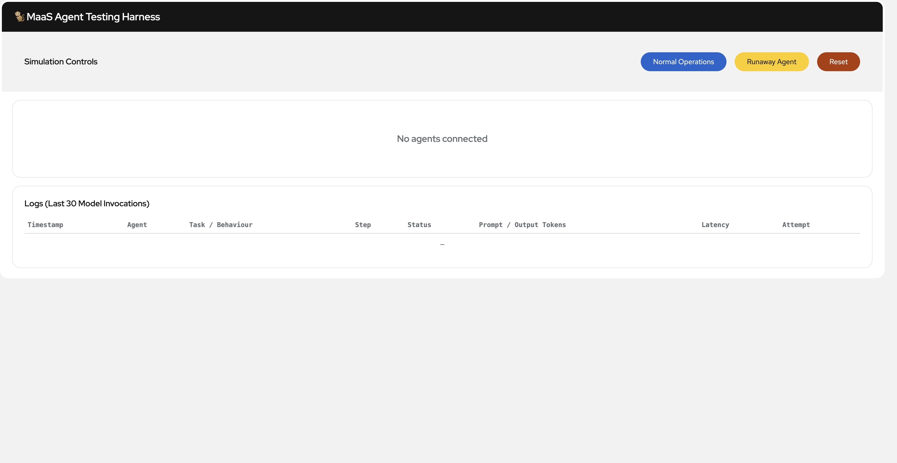
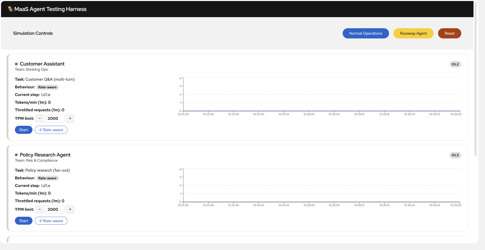
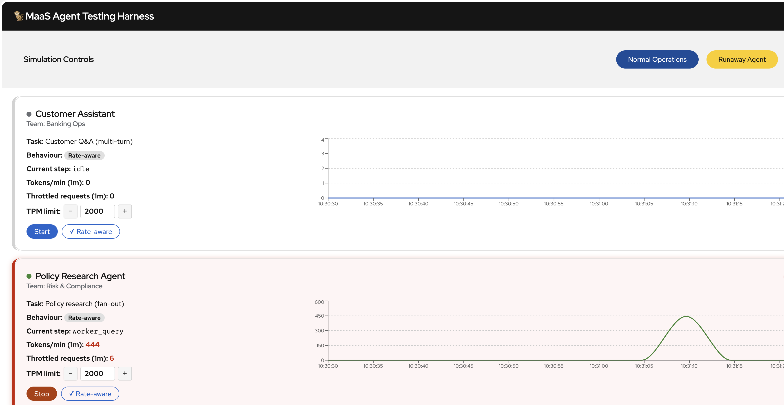

# Agent Testing Harness

A reusable harness for running LangGraph agents against any OpenAI-compatible LLM endpoint, observing live token consumption and rate-limiting behaviour, and comparing how different agent architectures respond to throttling — all through a live browser dashboard.

---

## What it does

- **Runs any number of agents simultaneously**, each in its own process, each with its own identity, team, and behaviour mode
- **Shows live token consumption** per agent on rolling 60-second charts
-  **Simulate agent behaviours** — run a `paced` agent and a `runaway` agent and test your system resilience
- **Enforces client-side rate limits** so agents stay within their budget without relying on server-side throttling
- **Controls agents from the browser**
- **Emits structured telemetry** after every model call — to stdout and to the dashboard

---

## Screenshots

**Empty state — no agents connected:**


**Three agents registered and idle:**


**Agents running — live token charts and event log:**


---

## Quick start

```bash
# 1. Install
git clone <repo-url> && cd maas-agent-demo
uv sync

# 2. Configure
cp .env.example .env
# Edit .env: set MAAS_ENDPOINT and MAAS_API_KEY

# 3. Build the UI
cd dashboard/frontend && npm install && npm run build && cd ../..

# 4. Start the dashboard
uv run dashboard        # → http://localhost:8000

# 5. Start an agent (new terminal)
MAAS_API_KEY=your-key DISPLAY_NAME="My Agent" TEAM_ID="My Team" uv run agent
```

Open [http://localhost:8000](http://localhost:8000) and click **Start** on the agent card.

For full setup details, see [**Getting Started**](docs/getting-started.md).

---

## Documentation


| Document                                           | What it covers                                                    |
| -------------------------------------------------- | ----------------------------------------------------------------- |
| [Getting Started](docs/getting-started.md)         | Install, configure, start the dashboard, connect your first agent |
| [Configuration Reference](docs/configuration.md)   | Every environment variable, what it does, and when to set it      |
| [Agent Modes](docs/agent-modes.md)                 | `naive`, `paced`, `runaway` — behaviour, retry logic, pacing      |
| [Dashboard Guide](docs/dashboard.md)               | Every control, metric, and indicator explained                    |
| [Writing an Agent](docs/writing-an-agent.md)       | How to write a new agent and plug it into the harness             |
| [How the Harness Works](docs/harness-internals.md) | ModelHarness, TokenBucket, TelemetryEmitter — internals           |
| [API Reference](docs/api-reference.md)             | All REST endpoints used by agents and the dashboard               |
| [Redesign Spec](docs/redesign-spec.md)              | Root-cause review + target architecture for the control/state/UI rewrite |
| [Phase 0 — Hotfixes](docs/phase-0-hotfixes.md)      | ✅ Landed low-risk fixes (stop reliability, role mapping, etc.)    |
| [Phase 1–5 Plan](docs/phase-1-5-implementation-plan.md) | Implementation plan for the full control-plane/budgets/scenarios/metrics/UI rewrite |


---

## Architecture

```
┌─────────────────────────────────────────────────────────────┐
│  One process per agent                                       │
│                                                              │
│  ┌──────────────┐  ┌──────────────┐  ┌──────────────┐       │
│  │ AgentWorker  │  │ AgentWorker  │  │ AgentWorker  │       │
│  │ user_id=a    │  │ user_id=b    │  │ user_id=c    │       │
│  │ mode=runaway │  │ mode=paced   │  │ mode=paced   │       │
│  └──────┬───────┘  └──────┬───────┘  └──────┬───────┘       │
│         │                 │                  │               │
│         └─────────────────┼──────────────────┘               │
│              POST /events   GET /control/{id}                │
│                            ▼                                 │
│                 ┌─────────────────────┐                      │
│                 │  FastAPI Dashboard  │  :8000               │
│                 │  + React UI (SSE)   │                      │
│                 └──────────┬──────────┘                      │
│                            │  Bearer token per agent         │
│                            ▼                                 │
│                 ┌─────────────────────┐                      │
│                 │  LLM Gateway        │  OpenAI-compatible   │
│                 │  /v1/chat/completions│  with rate limits   │
│                 └─────────────────────┘                      │
└─────────────────────────────────────────────────────────────┘
```

Each agent polls `GET /control/{user_id}` every second for start/stop/mode commands. Every model call emits a telemetry event to `POST /events`. The dashboard streams a live SSE update to the browser every second.

---

## Project structure

```
maas-agent-demo/
├── .env.example                  # Copy to .env — fill in MAAS_ENDPOINT and MAAS_API_KEY
├── pyproject.toml                # Python project + uv entry points
│
├── maasagentharness/                     # Main Python package
│   ├── config.py                 # Settings — reads .env and environment variables
│   ├── harness.py                # ModelHarness: LLM calls, retry, pacing, telemetry
│   ├── pacer.py                  # TokenBucket: smooth async rate limiter
│   ├── telemetry.py              # TelemetryEvent model + emitter
│   ├── runner.py                 # AgentWorker: main agent loop (uv run agent)
│   ├── probe.py                  # Rate-limit probe: 90s burst test (uv run probe)
│   │
│   ├── agents/
│   │   ├── triage.py             # Dispute triage: classify → extract → summarise
│   │   ├── research.py           # Policy research: plan → sequential workers → synthesise
│   │   └── assistant.py          # Multi-turn chat: streaming with history
│   │
│   ├── dashboard/
│   │   └── app.py                # FastAPI: /events, /control, /act, /reset, SSE, static files
│   │
│   └── data/
│       ├── letters/              # Synthetic dispute letters (triage corpus)
│       └── policies/             # Banking policy documents (research/assistant corpus)
│
├── dashboard/frontend/           # React + PatternFly v6 dashboard UI
│   ├── src/App.tsx               # Main dashboard component
│   └── dist/                     # Built output served by FastAPI
│
└── docs/                         # Full documentation
```

### Entry points


| Command            | Description                                                    |
| ------------------ | -------------------------------------------------------------- |
| `uv run dashboard` | Start the FastAPI dashboard on port 8000                       |
| `uv run agent`     | Start an agent worker (reads config from environment)          |
| `uv run probe`     | Run a 90-second rate-limit probe to characterise your endpoint |


---

## The included agents

Three agents are included as examples. Each demonstrates a different LLM usage pattern:


| Agent              | `AGENT_TYPE` | Pattern                                                 | Token profile                                                 |
| ------------------ | ------------ | ------------------------------------------------------- | ------------------------------------------------------------- |
| Dispute Triage     | `triage`     | Sequential 3-step graph: classify → extract → summarise | Input-heavy (\~700–800 prompt tokens per call), short outputs |
| Policy Research    | `research`   | Plan → sequential workers → synthesise                  | Burst pattern: 6–8 sequential calls per cycle                 |
| Customer Assistant | `assistant`  | Multi-turn streaming chat with history                  | Growing token cost per turn as history accumulates            |


All three use the same `ModelHarness` and are fully interchangeable with your own agent implementations.

---

## Rate-limit probe

Before running agents, you can characterise your LLM endpoint:

```bash
MAAS_API_KEY=your-key uv run probe
```

This sends requests continuously for 90 seconds and logs every response status, rate-limit header, and token count. Use it to find:

- The actual token-per-minute limit of your subscription
- Whether limits are per-user or per-team (shared pool)
- The rate-limit window type (fixed or sliding)
- Which response headers your gateway returns